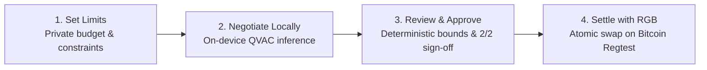

# Money with Memory (MwM)

> **Local AI negotiates. RGB settles. You stay in control.**

Money with Memory explores peer-to-peer digital asset swaps negotiated by local AI agents and settled using RGB on Bitcoin. Each party retains control over its private constraints, and both users approve the final agreement before settlement.

[](https://bitcoin.org)
[](https://github.com/RGB-Tools/rgb-lib)
[](https://github.com/QVAC-AI)
[](https://github.com/tetherto/wdk)
[](LICENSE)

---

## Team & Hackathon

* **Team:** Money with Memory (MwM)
* **Members:**
  * Lu ([@OhItsLu](https://github.com/OhItsLu))
  * Safet ([@SafetH16](https://github.com/SafetH16))
  * Domi ([@DomiiCatiti](https://github.com/DomiiCatiti))
* **Event:** Agentic Dollars on Bitcoin — BitPolito & RGB Protocol Association (BLOX, Torino, 17–18 Ottobre 2026)

---

## Target Demo Flow

*(Planned end-to-end workflow to be demonstrated during the hackathon)*



---

## Why RGB + QVAC?

* **RGB:** Enables the client-side validated digital asset settlement mechanism on Bitcoin tested by MwM without custodial intermediaries.
* **QVAC:** Provides on-device local AI inference so private reservation prices and trading limits are never leaked to cloud LLMs or public mempools.
* **Human approval:** Keeps transaction authorization strictly outside the AI agent.

---

## Planned Memory & Privacy Model

* **Private context:** The local agent operates within predefined limits on an allocated budget, keeping primary reserves segregated in a cold vault.
* **Counterparty memory:** Past interactions can inform trust and risk checks before committing capital (planned for application layer).
* **Human control:** The agent proposes; deterministic checks and user approvals govern settlement.

---

## Prepared Before the Hackathon

* **RGB protocol tests:** Pinned `rgb-lib` revision, experimental patch, and reproducible Regtest test suite (`patches/`, `scripts/`).
* **Regtest infrastructure:** Docker Compose setup for Bitcoin Core, electrs, and RGB Proxy (`compose.yaml`).
* **Local AI setup:** QVAC model configuration (`qvac.config.json`). Runtime and model availability depend on the local environment.

---

## To Be Built During the Hackathon

The application layer: bilateral AI negotiation, deterministic bounds validation, counterparty memory, user-facing approval flow, API/UI, and Tether WDK integration.

At kickoff, these application features are not yet implemented in this repository.

---

## Setup & Reproduction

### 1. Start Bitcoin Regtest & RGB Services
```bash
docker compose up -d bitcoind electrs proxy
docker ps --format "table {{.Names}}\t{{.Status}}\t{{.Ports}}"
```

### 2. Setup Python Virtual Environment
```bash
python3 -m venv .venv
source .venv/bin/activate
pip install -r backend/requirements.txt
```

### 3. Build Patched rgb-lib & Verify On-Chain Swaps

Clone `rgb-lib-python` with its submodules:
```bash
git clone --recurse-submodules https://github.com/RGB-Tools/rgb-lib-python.git
cd rgb-lib-python
```

Checkout PR #85 and apply the patch directly to the submodule compiled by the Python bindings:
```bash
cd rgb-lib
git checkout -B onchain-swaps 657c2a2fbcc053b5ae02483fd09808ce3f5cc026
git apply ../../patches/mwm-pr85-experimental-fixes.patch
cd ..
```

Build and install the Python bindings in editable mode:
```bash
pip install -e .
cd ..
```

Run the automated reproduction test suite:
```bash
./scripts/reproduce_all.sh
```

### 4. Start Local QVAC AI Server
Requires QVAC CLI (`qvac`) and local GGUF weights for `Qwen3-4B-Instruct`:
```bash
qvac serve --openai --port 11435 --config qvac.config.json
```
*(At kickoff, the runtime configuration is provided; the agent negotiation loop and leak guardrails will connect to this local endpoint during the hackathon.)*

---

## Security Scope

* All current validations run strictly on Bitcoin Regtest.
* AI agents never hold private keys or autonomous spending power. All on-chain transfers require explicit human confirmation.
