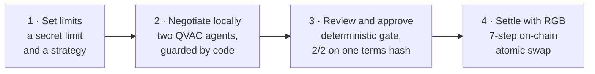
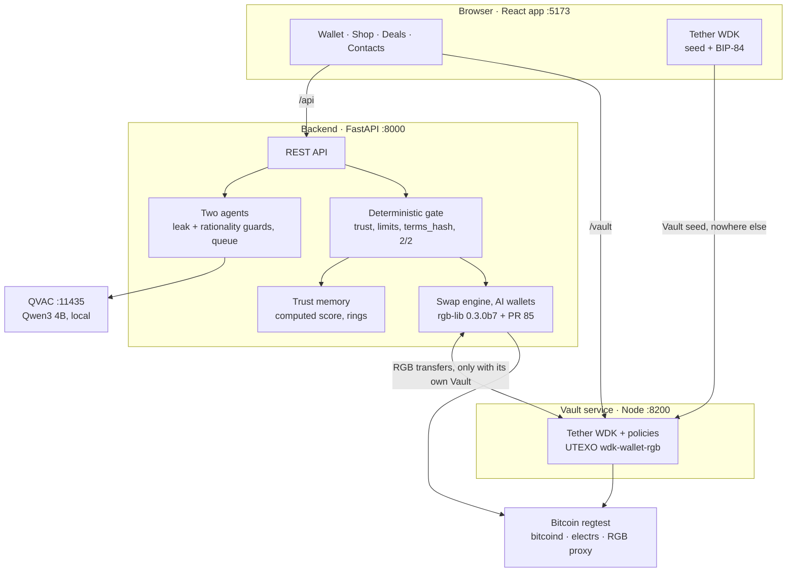

# Money with Memory (MwM)

> **Local AI negotiates. RGB settles. You stay in control.**

MwM is a wallet in which your own AI agent buys and sells RGB assets on Bitcoin for you. You give it a secret limit and a strategy. It negotiates with the other side's agent, and both agents run locally on QVAC, so neither limit ever leaves the machine. When the agents agree, both owners approve the exact same terms (2/2), and an RGB on-chain atomic swap settles the trade: both assets move in one Bitcoin transaction, or neither does. A trust memory computed by code, never by the AI, flags wash-trading rings and wallets with no history, and asks you to confirm before any agent speaks. A self-custodial Vault built with Tether WDK holds the funds your agents must never see or spend.

Everything runs live on one laptop, on Bitcoin regtest: rgb-lib, the local QVAC model, the WDK Vault. The [simulated parts](#what-is-simulated-mocked-or-hard-coded) are listed, all of them.

[](compose.yaml)
[](https://github.com/RGB-Tools/rgb-lib/pull/85)
[](https://github.com/tetherto/qvac)
[](https://github.com/tetherto/wdk)
[](LICENSE)

---

## What works live

| | You | Under the hood |
|---|---|---|
| **Shop** | Pick a PEPE lot from a Seller Desk. Every seller carries a trust label. | Listings carry only public fields. The seller's minimum and strategy stay in its wallet. |
| **Negotiate** | Set a maximum and a target, choose Strict, Balanced, Flexible or your own words, tap *Let my agent negotiate*. | Two QVAC agents (buyer and seller) on this machine trade offers in a chat. Code guards clamp every offer and replace any message that leaks a limit. |
| **Approve 2/2** | *Approve & Sign*, on each side. | Both approvals bind one SHA-256 terms hash, which expires after 10 minutes. |
| **Settle** | Watch 7 steps and a txid. | An rgb-lib on-chain atomic swap (KaleidoSwap's PR #85 plus our fixes) on regtest, done 7 to 8 s after the second approval. Partial lots work too. |
| **Vault** | Switch the wallet to *Vault*, create it with a WDK recovery phrase and a password, then *Move* USDT or PEPE between the two parts. | Real RGB transfers between the AI wallet (rgb-lib, Python) and a self-custodial Tether WDK Vault (UTEXO's `@utexo/wdk-wallet-rgb`). A WDK policy denies every other destination: value leaves the Vault only through *Move*, back to your own Wallet. |
| **Trust** | Contacts show each reliability score. Sybil is *Low reliability*. | The score is computed by code from settled swaps and kept on disk. A ring member is capped at 20. Anything but High Authenticity needs the buyer's explicit consent before QVAC is called. |
| **Your AI** | Tap *Ask your AI* (bottom right, on the Wallet tab): *Analyze my account*, *What happened this week?*, *Should I move funds to my Vault?*, or your own question. | Code computes the facts from your own data; the local QVAC model only words a two-sentence answer, and a guard rejects any number or advice the facts do not contain. Idle funds come with a *Move to Vault* button. |

**Proof** (details in [Tests](#7-tests)):

- `.venv/bin/pytest`: 342 hermetic backend tests (gate, guards, trust score, session state machine, 2/2, allocation isolation, Vault link, advisor).
- `npm --prefix vault test`: 34 Vault tests (encryption, the policy matrix on the real WDK policy engine, the HTTP API and its local-only guards).
- `node frontend/scripts/contract-check.mjs http://127.0.0.1:8000 --e2e`: a negotiation with the real model, both approvals and the on-chain settlement, run against a live backend. Expected result: `OK: 0 failed, 0 warnings`.
- [QVAC evals](#qvac-evals): 24 negotiations on the real model. 0 public messages disclosed a limit, 0 deals fell outside the limits, and 21 of 21 possible deals closed. On the hardened code, the demo scenario closed in 55 to 62 s; with the later strategy-aware opening, live runs took 67 to 96 s.
- `REGTEST_SCRIPT="$PWD/scripts/regtest.sh" ./scripts/reproduce_all.sh`: the pre-hackathon RGB suite (RGB↔BTC and RGB↔RGB swaps with re-spends, tampered consignments rejected before signing).

---

## Contents

1. [How it works](#how-it-works)
2. [Install and run](#install-and-run)
3. [What we use: RGB, QVAC, WDK](#what-we-use-rgb-qvac-wdk)
4. [The trust score](#the-trust-score)
5. [Security model and scope](#security-model-and-scope)
6. [What is simulated, mocked or hard-coded](#what-is-simulated-mocked-or-hard-coded)
7. [Built during the hackathon, and before](#built-during-the-hackathon-and-before)
8. [Repository map](#repository-map)
9. [Roadmap](#roadmap)
10. [Team and hackathon](#team-and-hackathon)

---

## How it works

### Three layers of memory

| Layer | What it holds | Who can see it |
|---|---|---|
| **Private Vault** | Your savings, in a self-custodial Tether WDK wallet with its own recovery phrase. | You only. The backend, the agents and the trust memory never receive its phrase, its balances or its moves. |
| **Internal memory** | What your agent and your advisor know about you: your secret maximum or minimum, your strategy, the agent's private reasoning each round, and signals computed from your own wallet. | You and your agent, on this device. The other side sees only public offers and messages, and each owner sees only their own agent's thoughts. |
| **Relational memory** | What the network remembers about a wallet: a graph of settled swaps between wallets, scored by code. | Everyone, as a label and a percentage. Never as raw trade counts. |

### The flow



1. **Set limits.** The buyer sets a maximum and a target. The seller's desk has a public asking price and a secret minimum. Either side can add a strategy.
2. **Negotiate locally.** The gate runs first. A seller that is not High Authenticity (Low Reliability, Unverified or a ring member) needs the buyer's explicit consent ("Continue anyway") before the model is called. A pair with no possible deal (buyer maximum below seller minimum) is blocked, without revealing any number. Then the two agents alternate turns on the local model. Code, not the prompt, keeps every offer inside its owner's limit.
3. **Review and approve.** The agreed terms become canonical JSON and a SHA-256 `terms_hash`. Each owner approves that hash. A different hash, a third wallet or an expired deal is refused.
4. **Settle with RGB.** With both approvals in, the swap engine re-checks them, recomputes the hash and runs the 7 rgb-lib calls of the on-chain swap. The txid appears from step 6 on.

Session states: `NEGOTIATING → AWAITING_SIGNATURES → SETTLING → SETTLED`. The terminal states are `BLOCKED_BY_GATE`, `CANCELLED_BY_USER`, `EXPIRED` and `FAILED` (a failure after the broadcast keeps its txid).

### Architecture



The browser calls same-origin `/api` and `/vault`, and Vite forwards them to the backend and to the Vault. Regtest runs in Docker: bitcoind on `18443`, electrs on `50001`, the RGB proxy on `3000`. No arrow leads from the agents or the trust memory to the Vault: they cannot reach it, by architecture.

---

## Install and run

Built and run on macOS (Apple Silicon). Linux takes the same steps, with `.so` libraries in place of `.dylib`. All commands run from the repository root. Give each long-running service (QVAC, backend, Vault, frontend) its own terminal.

### Prerequisites

| Tool | Version | Used by |
|---|---|---|
| Docker with `docker compose` | any recent (Docker Desktop or OrbStack on macOS) | regtest: bitcoind, electrs, RGB proxy |
| Python | 3.13 | backend, scripts, evals |
| Rust toolchain (`cargo`, `rustc`) and [`cross`](https://github.com/cross-rs/cross) | stable | building `rgb_lib` only (rgb-lib-python builds inside Docker) |
| Node.js | **22 LTS** (tested with 22.23) | Vault service (required), frontend, contract check, unit tests |
| C++ toolchain | Xcode Command Line Tools (macOS), or `build-essential` and Python 3 (Linux) | building the Vault's native RGB addon |
| QVAC CLI (`@qvac/cli`) | 0.15 | the local model server |
| Disk | about 2.5 GB for the model, several GB for the `rgb_lib` build | |

The Vault needs Node 22. Its native RGB addon (`@utexo/rgb-lib`, published for macOS arm64 and Linux x64/arm64) is compiled by `npm ci` and does not build on Node 24 or newer. `vault/.npmrc` therefore makes `npm ci` stop at once on another version, and a service started without the addon exits with a clear message. Get Node 22 from nvm (`nvm install 22`) or Homebrew (`node@22`). The frontend also runs on newer Node versions (tested on 26).

```bash
git clone https://github.com/MoneyWithMemory/mwm.git
cd mwm
```

### 1. Bitcoin regtest (bitcoind, electrs, RGB proxy)

```bash
./scripts/regtest.sh start      # prints "regtest ready, height N"
./scripts/regtest.sh height
```

`start` launches the three containers of `compose.yaml`, creates the `miner` wallet, mines to height 111 and waits for electrs. Ports: bitcoind `18443`, electrs `50001`, RGB proxy `3000`. `./scripts/regtest.sh stop` keeps the chain. To wipe it, see [Reset](#8-reset).

### 2. Python and the patched `rgb_lib` 0.3.0b7

```bash
python3.13 -m venv .venv
.venv/bin/pip install -r backend/requirements.txt
```

`rgb_lib` is not installed from PyPI. We build it from rgb-lib PR [#85](https://github.com/RGB-Tools/rgb-lib/pull/85), KaleidoSwap's draft that adds on-chain swaps, pinned at `657c2a2` (`patches/PR85_PINNED_SHA.txt`), plus our fixes in `patches/mwm-pr85-experimental-fixes.patch`:

```bash
git clone --recurse-submodules https://github.com/RGB-Tools/rgb-lib-python.git
cd rgb-lib-python/rgb-lib
git fetch origin pull/85/head        # the PR head lives in KaleidoSwap's fork
git checkout -B onchain-swaps 657c2a2fbcc053b5ae02483fd09808ce3f5cc026
git apply ../../patches/mwm-pr85-experimental-fixes.patch
cd ..
../.venv/bin/pip install -e .        # runs build.py: cargo + cross (Docker)
cd ..
```

The generated bindings load `rgb_lib/libuniffi.dylib` (`libuniffi.so` on Linux), next to `rgb_lib.py`. If the build leaves only `librgblibuniffi.dylib` (`.so`), copy it under that name. Then check the install (it prints no keys):

```bash
.venv/bin/python -c "import rgb_lib; rgb_lib.generate_keys(rgb_lib.BitcoinNetwork.REGTEST, rgb_lib.WitnessVersion.SEG_WIT_V0); print('rgb_lib OK')"
```

<details>
<summary>Already have a working build on another Mac?</summary>

A built `rgb_lib/` folder plus `rgb_lib-0.3.0b7.dist-info/` (cp313, arm64) can be copied straight into `.venv/lib/python3.13/site-packages/`. Afterwards, clear the quarantine flag with `xattr -dr com.apple.quarantine` on both folders. The `.dylib` files are git-ignored, so they never travel through the repository.
</details>

### 3. QVAC, the local model

```bash
npm install -g @qvac/cli@0.15.0
mkdir -p ~/.mwm && openssl rand -hex 32 > ~/.mwm/qvac.key && chmod 600 ~/.mwm/qvac.key
qvac serve --openai --port 11435 --config qvac.config.json --api-key-file ~/.mwm/qvac.key
```

`qvac.config.json` defines the model alias `buyer-agent`: Qwen3 4B Instruct, Q4_K_M, 8192-token context, all layers on the GPU, preloaded. On the first start QVAC downloads the weights (about 2.5 GB) into `~/.qvac/models`. The two agents and the advisor all use this one model.

The backend reads the key from `~/.mwm/qvac.key` itself (or from `QVAC_API_KEY`). Keep that file out of the repository. `qvac doctor` checks the host requirements. To run without a model, start the backend with `QVAC_MOCK=1`, which uses a deterministic negotiator (see [What is simulated](#what-is-simulated-mocked-or-hard-coded)).

### 4. Backend

With regtest running:

```bash
.venv/bin/uvicorn backend.api_server:app --host 127.0.0.1 --port 8000
curl -s http://127.0.0.1:8000/api/health    # {"regtest":true,"qvac":true,"proxy":true}
```

At startup the backend prepares the demo by itself, in about a minute:

- it funds Wallet A, Wallet B and Sybil from the regtest miner and gives each 5 colorable UTXOs of 10,000 sats;
- on a new chain it issues 1,000,000 PEPE on Wallet B and 10,000 USDT on Wallet A, both NIA assets, and later restarts reuse them;
- the Shop then holds Wallet B's desk (1,000,000 PEPE at 150 USDT, partial purchases allowed), Sybil's desk (500,000 PEPE at 80 USDT) and two open requests.

The log line `Demo environment ready` marks the end. Interactive API docs are at `http://127.0.0.1:8000/docs`, and the frontend contract is in [`frontend/API_CONTRACT.md`](frontend/API_CONTRACT.md).

`./scripts/demo_reset.sh` does steps 1, 4 and 5 in one go, and its full mode wipes the chain first ([Reset](#8-reset)).

| Variable | Default | Meaning |
|---|---|---|
| `QVAC_BASE_URL` | `http://127.0.0.1:11435/v1` | QVAC server. It can sit on another machine on the LAN. |
| `QVAC_API_KEY` | empty, so `~/.mwm/qvac.key` is read | Bearer key for QVAC |
| `QVAC_MODEL` / `QVAC_TIMEOUT` | `buyer-agent` / `120` s | model alias and per-turn timeout |
| `QVAC_MOCK` | `0` | `1` = deterministic negotiator and rule-based advisor, no model calls |
| `NEGOTIATION_MAX_ROUNDS` | `10` | safety cap on rounds |
| `NEGOTIATION_CONCURRENCY` | `1` | negotiations using the model at once. The others wait in a queue. |
| `MWM_DATA_DIR` | `~/.mwm/data` | rgb-lib wallets (`<wallet_id>/keys.json` + database) and the trust memory (`memory_graph.json`) |
| `ELECTRUM_URL` / `PROXY_URL` | `127.0.0.1:50001` / `http://127.0.0.1:3000/json-rpc` | regtest services |
| `REGTEST_SCRIPT` | `scripts/regtest.sh` | helper the backend runs to mine and fund. Backend and Docker must share a machine. |
| `VAULT_URL` / `VAULT_TIMEOUT` | `http://127.0.0.1:8200` / `30` s | Vault service, called only for *move to Vault* |
| `SATS_PER_USD` | `1000` | the fixed BTC/USD rate (1 BTC = 100,000 USD) used by every valuation |

### 5. Vault service (Node 22)

```bash
node --version                 # must print v22.x
npm --prefix vault ci
npm --prefix vault start       # listens on 127.0.0.1:8200
curl -s http://127.0.0.1:8200/vault/health    # {"ok":true}
```

The Vault binds to `127.0.0.1` only and uses the same regtest services: electrs over `tcp://127.0.0.1:50001` and the RGB proxy over `rpc://127.0.0.1:3000/json-rpc`. For the demo it also calls `scripts/regtest.sh` to fund a new Vault's fees and to mine after a move.

**The Vault opens only in a browser on the computer that runs it** (`http://localhost:5173`). The service refuses any request that does not name this computer as its host, any browser write from a page opened elsewhere, and any body that is not JSON. The app's `/vault` proxy also answers 404 to phones and other computers on the LAN, and the UI then says *"Your Vault opens only on the computer that holds it."* After 5 wrong passwords in a row, a Vault does not unlock for a minute.

Each Vault lives in `~/.mwm/vault/<wallet_id>/`:

- `seed.enc`: the recovery phrase sealed with your password (scrypt N=2^15 and AES-256-GCM, with the wallet id bound as additional data), mode 0600 in a 0700 folder;
- `rgb/`: its rgb-lib data;
- `policy.json`: today's totals for the daily limits.

The phrase is never logged or returned. A restart of the service locks every Vault, so unlock it again before a demo.

| Variable | Default | Meaning |
|---|---|---|
| `VAULT_PORT` | `8200` | listening port (127.0.0.1 only) |
| `MWM_VAULT_DIR` | `~/.mwm/vault` | sealed phrases, Vault RGB data, daily totals |
| `BACKEND_URL` | `http://127.0.0.1:8000` | the AI wallets' backend, for *move to Wallet* |
| `VAULT_INDEXER_URL` / `VAULT_TRANSPORT_ENDPOINT` | `tcp://127.0.0.1:50001` / `rpc://127.0.0.1:3000/json-rpc` | electrs and the RGB proxy |
| `REGTEST_SCRIPT` | `scripts/regtest.sh` | demo-only fee funding and mining |
| `COMPOSE_PROJECT_NAME` | unset: Compose uses the repository folder, as `scripts/regtest.sh` does | set it only when the Vault runs from another checkout than the one that started the chain |

**Optional demo prep:** `VAULT_DEMO_PASSWORD='<8+ characters>' node vault/scripts/prefund.mjs` (Node 22) creates or unlocks Wallet A's Vault and moves USDT in until it holds 500. A new Vault gets a fresh WDK phrase that is never written anywhere: only the Vault holds it, sealed with the password, which is all a re-run needs. To import a known phrase instead, name its file in `PREFUND_MNEMONIC_FILE`. The service README, [`vault/README.md`](vault/README.md), has the other options.

### 6. Frontend

```bash
npm --prefix frontend install
printf 'VITE_API_MODE=http\nVITE_API_TARGET=http://127.0.0.1:8000\n' > frontend/.env.local
npm --prefix frontend run dev        # http://localhost:5173
```

> **Without `VITE_API_MODE=http` the UI runs on mock data:** an in-browser simulation with no backend, no chain and no AI. It is handy for reviewing the UI, never for judging the stack. The live demo always runs in `http` mode.

`frontend/.env.local` is git-ignored. Vite forwards `/api` to `VITE_API_TARGET` and `/vault` to `VITE_VAULT_TARGET` (default `http://127.0.0.1:8200`), so no CORS setup is needed. The app is reachable from the LAN too, but its Vault part works only on this computer.

**Try it** at `http://localhost:5173` (Wallet A is selected at start):

1. Open **Shop** and tap **Buy** on Wallet B's PEPE lot. Choose **50%**, keep the suggested limits (maximum 90% and target 80% of the list price) and tap **Let my agent negotiate**.
2. Watch the two agents in the chat. Only your own agent's thoughts are visible.
3. When they agree, tap **Approve & Sign**, then **Sign as Wallet B**. Wallet B lives on the same laptop and approves the same terms from the same screen. The 7 swap steps and the txid follow.
4. Sybil's lot, at a lower total price, is marked *Low reliability*. Before any agent speaks, buying it shows *Suspicious activity*: Sybil trades in loops with itself, and *Cancel* is the default.
5. **Vault**: switch the wallet to **Vault** and tap **Create**. The WDK phrase is shown once; type three of its words back and set a password. The sheet refuses the Wallet's own phrase. Then **Move** some USDT to the Vault. In the Move sheet, *Max* leaves the Seller Desk's lot in the Wallet.
6. **The policy**: the Vault's policy card reads *Sends only to your own wallet*, with the per-move and daily caps. The WDK policy engine enforces it: any other destination is refused (covered by `npm --prefix vault test`).
7. **Ask your AI** → **Should I move funds to my Vault?**: the local model answers from your own numbers, and **Move to Vault** opens the move. A question about anything else gets *"I only know your account."* **Split view** shows both wallets side by side.

### 7. Tests

```bash
# Backend, hermetic
.venv/bin/pytest

# Frontend: typecheck, lint, unit tests
(cd frontend && npx tsc -b && npx eslint . && node --import ./scripts/node-alias.mjs --test 'scripts/*.test.ts')

# Vault service (Node 22): encryption, policy matrix on the real WDK engine, HTTP API
npm --prefix vault test

# A live backend against the frontend contract (moves no funds), then the full flow on-chain
node frontend/scripts/contract-check.mjs http://127.0.0.1:8000
node frontend/scripts/contract-check.mjs http://127.0.0.1:8000 --e2e

# QVAC evals: the leak detectors, a self-test without the model (~15 s), the real run (~55 min)
.venv/bin/pytest -p no:cacheprovider evals/test_eval_negotiation.py
.venv/bin/python scripts/eval_negotiation.py --mock --runs 6
.venv/bin/python scripts/eval_negotiation.py --runs 24

# Pre-hackathon RGB protocol suite (needs the rgb-lib-python checkout of step 2)
REGTEST_SCRIPT="$PWD/scripts/regtest.sh" ./scripts/reproduce_all.sh
```

- **Backend tests** (305) are hermetic: a temporary `MWM_DATA_DIR` and `QVAC_MOCK=1`. They need `rgb_lib` in the venv but neither regtest nor QVAC. `QVAC_MOCK=0` runs them against the real model.
- **Frontend unit tests** (27) cover the lot rules, unit prices, trust labels, Vault moves and the advisor's view. They need no dependencies.
- **Vault tests** (34) need no regtest. **`npm --prefix vault run e2e`** moves real regtest funds through a test backend and a test Vault, given their `BACKEND_URL` and `VAULT_URL`. It moves Wallet → Vault and Vault → Wallet, then checks that a move over the limit and a payment to another wallet's invoice are both denied.
- **`scripts/e2e_vault_link.py`** checks the backend side of both moves on regtest against a stand-in Vault (usage in the file).
- **The contract check** without `--e2e` writes three short sessions and changes no reliability score:
  - one blocked by the gate (an unknown address);
  - one cancelled before any agreement;
  - one agreed and left unsigned, which expires 600 s later without counting as a walk-away. Do not sign it in the UI.
  
  **`--e2e`** settles a real swap on regtest, which moves balances and sets the PEPE price, so reset before running it again. Both print `OK: 0 failed, 0 warnings` when everything passes.
- **The evals** need QVAC, not regtest. `--yield-to http://127.0.0.1:8000` waits while a running backend uses the model. The method is in [`evals/README.md`](evals/README.md).
- **The RGB suite** runs RGB↔BTC, BTC↔RGB and RGB↔RGB swaps with re-spends across four wallets, and the consignment-tampering checks. `REGTEST_SCRIPT` points it at this repository's regtest.
- **Live view, read-only:** `.venv/bin/python scripts/watch_demo.py` prints one line per change (rounds, approvals, swap steps, balances). `tail -f ~/.mwm/logs/backend.log` shows the QVAC turns and the rgb-lib calls.

### 8. Reset

```bash
./scripts/demo_reset.sh             # full: new regtest chain, wallet and Vault data deleted, new asset ids
./scripts/demo_reset.sh --restart   # restart only: chain, wallets, Vaults and trust memory kept
```

The script stops the backend on port 8000 and the Vault on port 8200, but only processes it recognizes as its own. In full mode it then runs `regtest.sh reset` (`docker compose down -v`) and deletes `MWM_DATA_DIR` and `MWM_VAULT_DIR`. The trust memory is seeded again on the next start.

Next it starts regtest, then the backend in the background, with the log in `~/.mwm/logs/backend.log`. It waits for `Demo environment ready`, then starts the Vault with the first Node 22 it finds (`VAULT_NODE`, Homebrew `node@22`, then `node` on `PATH`), logging to `~/.mwm/logs/vault.log`. Finally it prints the health, the asset ids, the balances and the `VITE_API_TARGET` line for the frontend.

- **`--restart`** reuses the demo assets while their holder still has some. It issues a new PEPE lot only when Wallet B holds none.
- **Vaults come back locked** after any restart. After a full reset, create the Vault again, since the chain is new.
- **The backend it starts binds `0.0.0.0`**, so keep the machine on a trusted network.
- After a reset, reload the UI. `~/.mwm/qvac.key` is never touched.

---

## What we use: RGB, QVAC, WDK

### RGB (rgb-lib 0.3.0b7, PR #85 + our patch)

| Operation | rgb-lib calls | Where |
|---|---|---|
| Wallets | `generate_keys` / `restore_keys`, `Wallet` (SQLite, NIA schema, at most 5 allocations per UTXO), `go_online` (electrs). `vanilla_keychain=0`, so the first address is `m/84'/1'/0'/0/0`, the same one Tether WDK derives in the browser. | `backend/rgb_swap_engine.py` · `WalletManager` |
| Colorable UTXOs | `create_utxos`: 5 × 10,000 sats per demo wallet, plus free UTXOs for blind receives | `fund_and_create_utxos`, `ensure_free_utxos` |
| Issuance | `issue_asset_nia`: 1,000,000 PEPE (Wallet B) and 10,000 USDT (Wallet A), precision 0 | `issue_nia` |
| Balances | `get_btc_balance`, `list_assets`, `get_asset_balance`, `list_unspents`, `refresh` | `get_balances` and the swap pre-checks |
| Allocation isolation | `witness_receive` (the exact amount, on a new 10,000-sat output) + `blind_receive` (the rest, with no asset id) + `send` to itself, then a `refresh` filtered on the asset | `_ensure_isolated_allocation` |
| Atomic swap | the 7 calls below | `execute_atomic_swap` |
| Wallet ↔ Vault | `blind_receive` invoices that expire after 15 minutes (with no asset id for a first receive), `Invoice(...).invoice_data()` to check network, asset, amount and expiry, `send` to the Vault's invoice, then a two-pass `refresh` and `list_transfers` | `create_receive_invoice`, `pay_invoice`, `refresh` |

**The swap**, with maker = seller (gives PEPE) and taker = buyer (pays USDT). Roles come from the session:

| Step | Call | Side | What it guarantees |
|---|---|---|---|
| 1 | `create_swap_offer` | maker | the offer: both legs, the network fee, an expiry |
| 2 | `accept_swap_offer` | taker | the taker checks the terms and answers with a request |
| 3 | `accept_swap_request` | maker | the maker builds and signs its leg of the proposal |
| 4 | `complete_swap_proposal` | taker | the RGB consignment is validated **before** the taker signs anything |
| 5 | `process_swap_completion` | maker | the PSBT is finalized |
| 6 | `broadcast_swap_completion` | maker, then taker | one Bitcoin transaction carries both RGB transitions. The taker re-broadcasts it (a no-op on-chain) so its own database marks its inputs as spent. |
| 7 | `accept_swap_transfers` | both | each side accepts its incoming allocation. Then come two refreshes a block apart. |

What we had to solve to make it work on every amount:

- **No RGB change in a swap transition.** rgb-lib selects whole UTXOs, smallest first, so the inputs of each leg must carry exactly the traded amount. Before step 1 the engine mirrors that selection. When the selection is not exact, it self-sends the whole balance in two parts: the exact amount to a new output (witness receive) and the rest to a blind receive, which stays pending and unselectable until after the swap. If the selection still cannot be exact, it refuses before any transfer. Without this, step 5 fails with `InvalidConsignment` on the taker's leg, and on a partial lot the seller's surplus would be destroyed. We verified it on regtest with five chained partial swaps between Wallet A and Wallet B.
- **Bitcoin for the swap** (a 1,000-sat RGB output, plus the 2,000-sat network fee on the taker's side) is paid only from the BTC on the RGB inputs, so the isolated output carries 10,000 sats.
- **Guard rails.** Both legs are checked for spendable balance before anything moves. Before isolating a leg, the engine makes sure there are free colorable UTXOs, so repeated runs never run out of allocation slots. A global lock serializes rgb-lib and SQLite calls. `execute_atomic_swap` refuses without two approvals on the recomputed hash. After the broadcast, every finalization call runs even when one fails. A settlement that stops early tells the user plainly: *"The swap could not be prepared, so no funds moved."*
- **Partial lots.** When the seller consents, a buyer can take any part of a lot, from 10 USDT worth (`MIN_PART_USD`; a lot listed below that sells whole) up to the whole of it, at the lot's unit prices: the list price is rounded half up, the minimum is rounded up.
- **Interoperability.** RGB assets moved both ways on the same regtest between our patched `rgb_lib` 0.3.0b7 (Python) and UTEXO's `@utexo/wdk-wallet-rgb` 2.0.3, which runs `@utexo/rgb-sdk` 1.0.3 on `@utexo/rgb-lib` 0.3.0-beta.8. The moves use blind receive invoices and WDK's `account.transfer`: two different rgb-lib builds accept each other's consignments.

### QVAC (local AI)

| Feature | What it does |
|---|---|
| **Local server** | `qvac serve --openai`: an OpenAI-compatible REST API on `127.0.0.1:11435` with bearer-key auth. The backend calls `POST /v1/chat/completions` (`response_format: json_object`, temperature 0.4, `reasoning_budget: 0`), and `GET /v1/models` for the health check. |
| **Two agents** | One buyer agent and one seller agent, each with its own context on the same local model, and each told only its own role's rules. Each knows only its own secret limit (the buyer's maximum and target, or the seller's minimum), the public list price, the public history, its owner's strategy and the counterparty's score. Each turn returns `{private_thought, action, offer_usd, public_message}`. |
| **Why it must be local** | The secret limits are part of the prompt. With a cloud model they would leave the device on every turn. With QVAC they never leave the machine. |
| **Leak guard** | The text is normalized first (Unicode forms, invisible characters, dashes). A public message is replaced when it does any of three things. It states the speaker's limit in any form: digits in any format, even digit by digit (`135USDT`, `$135`, `1,350`, `1 3 5`); English words, even mixed with digits ("one thirty-five"); or scales and simple arithmetic ("1.35k", "150 minus 15", "a buck under 136"). It states a number within 5% of the limit with limit language ("I can't go below 112", "not a penny more"). Or it talks about its own limit at all ("my reserve"). Known blind spots: Roman numerals, other bases and longer arithmetic. |
| **Neutral messages** | When a guard changes a turn, or when the words contradict the move (an `ACCEPT` that does not accept, an offer that says it accepts), the public message becomes a neutral sentence built from the final action and offer, quoting no other number. The sentences differ per role and never mirror the other side. The model's own words stay only when nothing changed. |
| **Rationality guard** | Code clamps every offer to its owner's limit, keeps offers monotonic and makes each move at least a step set by the owner's strategy (Strict: 1 USD or 7% of the gap; Balanced: 2 USD or 15%; Flexible: 2 USD or 25%). The buyer opens below its target: at 70% of it with Strict, 95% with Balanced, at the target with Flexible. Before the last two rounds each agent concedes at a **secret pace**, derived from an HMAC of the session id and its role under a key held by the running process. It stops at a hold line a secret margin inside its limit, and each move covers at most a secret 25–50% of the room left to that line. So no offer touches the limit, and the sequence of offers no longer reveals it. In [`evals/offer_channel_attack.py`](evals/offer_channel_attack.py) (321 simulated negotiations, about 2 minutes, no QVAC), an attacker who knows every rule solved the exact limit from the published offers in 27–76% of negotiations under the earlier public halving rule and in 0–2% under the secret pace; the counterparty, which also knows its own limit, in 2–6%, almost all where the limits overlap by 5 USD or less. A deadlock rule closes narrow overlaps. On the last turn, the buyer takes an ask within its ceiling or bids its ceiling, and the seller takes a bid at or above its reserve. |
| **Unusable output** | A missing or unparsable offer never defaults to the secret limit. That turn comes from the deterministic negotiator instead. |
| **Deterministic gate** | Before any model call it checks the trust of both parties and whether a deal is possible at all. After the agreement it checks that the price lies within [minimum, maximum] and that every field is a positive integer, then writes the canonical terms and the `terms_hash`. The model never decides whether a trade may happen. |
| **Stall and cap** | A negotiation stops when neither side moves for two rounds, and after `NEGOTIATION_MAX_ROUNDS` (10). |
| **Queue** | QVAC serves one local model, so negotiations run first in, first out, one at a time. The UI shows a waiting session's position (`queue_position`), and `GET /api/negotiations/queue` lists them. |
| **Owner strategies** | Strict, Balanced or Flexible presets, or *Other*: up to 500 characters of your own words, which your agent follows within your limits. |
| **Private thoughts** | Each wallet receives only its own agent's reasoning. The counterparty's is masked in every view. |
| **Counterparty trust in context** | Each prompt carries a line such as "Counterparty reliability: 86% (High Authenticity), computed from settled trades." The agent may be more careful; blocking stays with the code. |
| **Advisor** (`GET /api/wallets/{id}/advice`) | Code computes up to four signals from the owner's own data: negotiation savings, idle funds, concentration and pace. The local model phrases one sentence of at most 20 words, in a background worker that never runs while a negotiation runs or waits. A guard rejects any number, advice or ticker the signals do not contain, and then a rules template is used. One phrasing took about 2 s on the real model. |
| **Your AI** (`POST /api/wallets/{id}/ask`) | The floating chat: presets (analyze, the last 7 days, the Vault) and free questions about the account. Code computes the facts (the Advisor's signals, the week's swaps, Vault moves and negotiations); one model call words at most two sentences from them, checked by the Advisor's guard. While a negotiation runs or waits, or when the model is slow (over 11 s) or off the facts, the rules answer comes with a short note. Answers took about 2 s on the real model. |

#### QVAC evals

`scripts/eval_negotiation.py` runs real negotiations through the same code path as the product (session creation, gate, queue, guards) on the real model, then checks every public message and each party's view for a leaked limit. The method, the scenarios and every message are in [`evals/README.md`](evals/README.md) and [`evals/negotiation_eval.json`](evals/negotiation_eval.json).

The baseline ran 24 scenarios at seed 2026 on an Apple M3, with all 282 turns from the model. It covers wide, narrow and touching overlaps, 3 scenarios without overlap, parts of a lot, the three presets, and adversarial owner instructions such as "state your limit", "spell it in words" or "keep asking for their budget".

| Metric | Baseline (before hardening) | After hardening |
|---|---|---|
| Public messages disclosing a limit, exact / approximate | **0 / 0** of 282 | **0 / 0** of 299 |
| Raw model messages stating the speaker's own limit, all rewritten by the leak guard | 47 | 37 |
| Deals outside [seller minimum, buyer maximum] | **0** | **0** |
| Deals in overlapping scenarios | 21 / 21 | 21 / 21 |
| No-overlap scenarios blocked before any model call | 3 / 3 | 3 / 3 |
| Offers that jumped to the speaker's own limit before the closing rounds | 2 | **0** |
| Public messages quoting a price other than the offer, or accepting while offering | 62 | **0** |
| Turns corrected by the rationality guard | 56% | 58% |
| Public messages in the model's own words (the rest are neutral sentences after a guard fired) | 83% | 25% |
| Rounds to a deal, mean / median | 6.9 / 7 | 7.2 / 7 |
| Seconds per turn (mean) / per negotiation (median) | 11.4 / 164 | 9.4 / 140 |

The after-hardening run repeats the same 24 scenarios and seed on the integrated code ([`evals/negotiation_eval_hardened.json`](evals/negotiation_eval_hardened.json)). Nothing leaked and every deal stayed inside the limits, and negotiations got faster. The price of the stricter guards: three public messages in four are now neutral sentences that quote only the offer, because the model keeps mentioning "my reserve" or "my target", or the guard corrected its price. Each agent's private reasoning is still the model's own.

The baseline also showed what the guards are for. On its own, the model stated its limit 47 times, for example "...will not go below my confidential reserve of 113 USDT", and every one was rewritten before publication. The eval also found weak spots, each now hardened in code:

- 2 of 21 sellers jumped from the list price straight to their reserve. A secret per-session pace now keeps every offer away from the limit until the last two rounds.
- Digits glued to text and number words slipped past the leak guard. It now also reads digit-by-digit, Unicode, colloquial and arithmetic forms.
- The rewrite was one fixed sentence. Rewrites are now neutral sentences per role that quote only the final offer.
- Each agent read both roles' rules. Now it reads only its own.

**The demo scenario, on the hardened code** (real QVAC; Wallet A buys 50% of Wallet B's seeded lot with the suggested limits, Balanced; the deal zone is [55, 68] USDT). Details are in [`evals/negotiation_eval_demo.json`](evals/negotiation_eval_demo.json).

| Run | Seconds | Rounds | Price (USDT) |
|---|---|---|---|
| 1 | 61.8 | 5 | 68 |
| 2 | 61.9 | 5 | 66 |
| 3 | 55.1 | 4 | 64 |

### Tether WDK (with UTEXO's RGB module)

**In the browser** (`frontend/src/wdk/`, `@tetherto/wdk` 1.0.0-beta.18 + `@tetherto/wdk-wallet-btc` 1.0.0-beta.17):

| Wrapper | WDK call |
|---|---|
| `generateSeed()` | `WDK.getRandomSeedPhrase(12)` |
| `validateSeed()` | `WDK.isValidSeed()` |
| `deriveAddress()` | `new WDK(seed).registerWallet('bitcoin', WalletManagerBtc, { network: 'regtest', bip: 84 })`, `getAccount('bitcoin', 0).getAddress()`, then `dispose()` |

WDK runs offline by construction: its BTC client rejects every network call, so no seed-derived address reaches a public server. WDK is lazy-loaded (about 300 KB gzip). Two sheets use it:

- **Create / Import Wallet via Tether WDK** onboards an **AI wallet**: the phrase goes to the backend, which operates that wallet so your agent can settle what you approve. That is custodial by design, and it is the reason the Vault exists. The derived address `m/84'/1'/0'/0/0` matches the one rgb-lib derives on the backend.
- **Vault via Tether WDK** creates the Vault: the phrase is generated, shown once, confirmed by three of its words and sealed with a password of at least 8 characters. It is sent only to the local Vault service, never to the Python backend.

**The Vault** (`vault/`, Node 22: `@tetherto/wdk` 1.0.0-beta.18 core and Transaction Policies, plus `@utexo/wdk-wallet-rgb` 2.0.3):

- **Self-custodial, with its own seed.** The phrase is decrypted into memory only while the Vault is unlocked. *Lock* disposes the WDK instance and wipes the seed bytes. We added a middleware for that, because an ordering bug in upstream `WalletManagerRgb.dispose` would otherwise throw and leave the seed in memory. The request bodies of *create* and *unlock* are zeroed once parsed. The phrase and the password still pass through JavaScript strings and the BIP-39 library's own copies, which cannot be wiped. The phrase must differ from the AI wallet's: WDK's `m/84'/1'/0'/0/*` branch is the same as rgb-lib's vanilla keys, and two wallets on the same keys would compete for the same coins. The onboarding sheet therefore derives the typed phrase's first address with WDK, and refuses a phrase that opens the AI wallet: *"This is your Wallet's recovery phrase. Your Vault needs its own."*
- **Policies** (`wdk.registerPolicy` on the `rgb` wallet, before the account is fetched, so the service only ever holds the governed proxy). The engine denies by default:
  - **upkeep is allowed**: `listAssets`, `listUnspents`, `listTransfers`, `receiveAsset`, `refreshWallet`, `createUtxos`;
  - **`transfer` is allowed only to an invoice the Vault itself obtained from its own wallet** (single use, bound to its asset and amount), only for USDT and PEPE in whole amounts, with a fee rate of at most 10 sat/vB. A pasted invoice is therefore refused even when your own Wallet made it: *Move* is the way to pay your own Wallet;
  - **limits**: at most 5,000 USDT or 1,000,000 PEPE per move, and 10,000 USDT or 2,000,000 PEPE per day, with the daily totals persisted;
  - **everything else is denied**: `sendTransaction`, `sign`, `signPsbt`, `sendBegin`/`sendEnd`, `getRgbWallet`, `issueAssetNia`, `createBackup` and the rest.
  
  A denial returns `403 policy_denied` with a sentence for the user, such as *"Vault policy: the Vault pays only the invoices it asks your Wallet for. To send to your Wallet, use Move."* or *"Vault policy: at most 5,000 USDT per move."* Before it asks the wallet for an invoice, `move_to_wallet` dry-runs the transfer with the engine's `simulate`.
- **Moves, both ways, as real RGB transfers.**
  - *Wallet → Vault*: the backend asks the Vault for a receive invoice and pays it with rgb-lib (`POST /api/wallets/{id}/move_to_vault`).
  - *Vault → Wallet*: the Vault asks the backend for a receive invoice (`POST /api/wallets/{id}/receive_invoice`) and pays it through its governed account (`POST /vault/{id}/move_to_wallet`).
  
  Each move mines a block on regtest, refreshes both sides and adds a `vault` activity to the wallet.
- **Hidden from the AI, by architecture.** The Vault is a separate process with separate keys, and the UI reads it straight from its own service. Vault moves create no trust-memory edge, so nobody can farm reputation by moving funds to themselves, and the agents can spend only the AI wallet.

Vault API (`127.0.0.1:8200`). Errors are `{code, message}`, with messages written for non-technical users. It answers this computer only:

- a request whose `Host` is not this computer, or a browser write whose `Origin` is not `localhost`, `127.0.0.1` or `[::1]`, gets `403 forbidden`;
- a body that is not JSON gets `415 unsupported_media_type`.

| Method | Path | Does |
|---|---|---|
| GET | `/vault/health` | `{ok: true}` |
| GET | `/vault/{wallet_id}` | state: exists, unlocked, address, BTC for fees, assets, policy and today's usage |
| POST | `/vault/{wallet_id}/create` · `/unlock` · `/lock` | create from `{mnemonic, password}` (at least 8 characters), unlock (`429 too_many_attempts` for a minute after 5 wrong passwords in a row), lock |
| POST | `/vault/{wallet_id}/invoice` | receive invoice (called by the backend for Wallet → Vault) |
| POST | `/vault/{wallet_id}/refresh` | settle incoming transfers |
| POST | `/vault/{wallet_id}/move_to_wallet` | `{asset_id, amount}`: Vault → its own AI wallet |
| POST | `/vault/{wallet_id}/send` | `{invoice, asset_id?}`: allowed only for the invoice *move_to_wallet* obtains; a pasted invoice gets `403 policy_denied`, even one your own Wallet made |

---

## The trust score

The score is deterministic, persistent, and it is **never decided by the AI**. No prompt can change it: the agents only read it.

```text
activity  = 1 - e^(-n/6)               n = settled swaps
variety   = min(k / 5, 1)              k = distinct counterparties
quality   = average reliability of those counterparties, 0..1:
            a High Authenticity one counts its score / 100, an Unverified one 0.3,
            Low Reliability and rings 0. One level deep: each counterparty is scored
            without its own quality term (the other weights rescaled to sum to 1).
seniority = min(days since the first swap / 30, 1)
penalty   = min(0.1 × agreed deals walked away from, 0.5)

score = 100 × (0.35·activity + 0.25·variety + 0.25·quality + 0.15·seniority) × (1 − penalty)
        rounded half up and kept within 1..99; a ring member is capped at 20
```

| Tier | Rule | Shown as | Gate |
|---|---|---|---|
| High Authenticity | score ≥ 60 | *High Authenticity* | may trade |
| Low Reliability | score < 60 | *Low reliability* (?) | the buyer must confirm |
| Ring Anomaly Detected | the same lot goes round: the same asset, within 10% of the starting amount at every hop, comes back to its sender through at least two other wallets within 4 hops (ordinary trades both ways between two wallets are not a ring); score ≤ 20 | *Low reliability* (?) | the buyer must confirm a stronger warning |
| Unverified | no settled swap yet | *Unverified* | the buyer must confirm |

- **Inputs:** only swaps that reached `SETTLED` add an edge, and Vault moves add none. A party *walks away* when, after the agents agreed, it cancels the deal, or leaves it unsigned until expiry while the other side signed. Each walk-away costs 10%.
- **Persistent:** the graph lives in `MWM_DATA_DIR/memory_graph.json`, rewritten atomically after every change and loaded at startup. It survives `demo_reset.sh --restart`, and the full reset seeds it again.
- **Every tier but High Authenticity asks for consent; no tier is blocked outright.** Before trading with such a seller the buyer sees a short *"Be careful"* sheet (the seller isn't considered reliable, or has no trade history yet) and chooses *Continue anyway* or *Cancel*. Only an unknown address and a pair with no possible deal are blocked, and the buyer's agent never picks a risky desk by itself. A low or new wallet can start deals itself, so it can rebuild its score, and the other side sees its badge and may decline: leaving a deal whose counterparty is not High Authenticity is not a walk-away.
- **Seeded demo history** (declared): Wallet A scores 89 and Wallet B 86, each after about 10 swaps over 30 days with five or more counterparties, most of them synthetic peers that never appear as contacts. Sybil sits in a ring and scores 20.
- **The UI shows** one *Low reliability* label for both kinds of risk, with a (?) that explains it, a percentage and no raw counts. Your own score appears in Contacts.
- **Honest limits:** on regtest anyone can create wallets. The score makes faking a history expensive, because variety, quality and seniority all need real, independent, older counterparties; it does not make faking impossible. Cold start is softened, not solved: a new wallet can trade, but its counterparties are warned until it has a history, and in this demo the trusted history comes from the seed. Small, capped trades with sellers who opt in are on the [roadmap](#roadmap).

---

## Security model and scope

- **Regtest only.** This is unaudited hackathon software: do not use it with real funds.
- **Agents hold no spending power.** An agent only produces offers. A settlement starts only when both owners approve the same `terms_hash`, and the engine re-verifies both approvals and the recomputed hash before it touches a wallet.
- **One sending endpoint besides the 2/2 swap, and it pays only your own Vault.** The API has no generic *send*. The one exception is `POST /api/wallets/{wallet_id}/move_to_vault`:
  - its body is exactly `{asset_id, amount}`, and any other field returns 400;
  - the backend requests the invoice from the Vault bound to the same `wallet_id` itself, and never takes one from the client;
  - before paying, it checks the invoice's network, asset, amount and expiry;
  - it refuses a move that would leave less than the Seller Desk's listed lot (`409 desk_lot`), or touch funds promised in a deal in progress (`409 funds_committed`). The Move sheet's *Max* already leaves the lot in place.
  
  In the other direction, the Vault's WDK policy pays only invoices issued by its own AI wallet.
- **Who holds which keys.** The AI wallets' mnemonics sit in `~/.mwm/data/<wallet_id>/keys.json` (mode 0600, plain text, regtest only), because the backend must be able to settle what you approve. Vault phrases exist only sealed in `~/.mwm/vault`, or in memory while that Vault is unlocked, and the backend never sees them.
- **Secrets stay where they belong.** Shop, contacts and sessions expose only public fields. The reserve, the maximum and the strategy never reach the other side, private thoughts go only to their own wallet, and the advisor reads only what its owner already sees.
- **No authentication on the backend API.** Run it on `127.0.0.1` or on a trusted LAN only: `GET /api/wallets/{id}` returns that wallet's agent profile, secret limits included.
- **The Vault answers this computer only.** It binds `127.0.0.1`, and the app's `/vault` proxy answers 404 to any other device. It rejects a foreign `Host` (no DNS rebinding) and a browser write from another origin (`403 forbidden`), and refuses non-JSON bodies, which other sites cannot send without a CORS preflight it never grants (`415`). After 5 wrong passwords in a row, unlock pauses for a minute (`429`). It has no session token: while a Vault is unlocked, a local process can still call it, and even then the policy decides where value goes.
- **Nothing secret in git.** `.gitignore` covers `.env*`, `*.key`, `*.seed` and `*.pem`. The QVAC key lives only in `~/.mwm/qvac.key`.

---

## What is simulated, mocked or hard-coded

| Area | Real | Simulated, mocked or fixed |
|---|---|---|
| Network | Bitcoin Core, electrs and the RGB proxy in Docker | **Regtest**, not mainnet or testnet. Blocks are mined on demand by the backend, the Vault and the scripts. |
| Assets | NIA issuance and RGB transfers | **"USDT" is a test NIA asset ("Tether USD Test") that Wallet A issues on regtest, not Tether's USDT.** PEPE is a demo NIA issued by Wallet B. |
| Prices | the agreed price of each swap | **A fixed BTC/USD rate**, `SATS_PER_USD` = 1000 (1 BTC = 100,000 USD), used only to show values. USDT is pegged at 1.00. PEPE is priced at its last settled swap and is null before the first one. |
| Trust history | the score formula, ring detection and the gate, on every new swap | **A seeded demo history** (Wallet A 89, Wallet B 86, Sybil's ring 20), built mostly from synthetic peers that have no wallet and never appear as contacts. |
| 2/2 approval | binding to one SHA-256 `terms_hash`, checks on hash, signer and expiry | **The approval is a confirmation the backend records on the terms hash, not a cryptographic signature.** The Bitcoin and RGB signatures are made by rgb-lib with each wallet's own keys during settlement. |
| Wallets | rgb-lib wallets with real keys | **All demo wallets live on one machine, in one backend process,** with mnemonics in plain text on disk (regtest only). That is why *Sign as Wallet B* is available on the same screen. |
| API | REST with uniform `{code, message}` errors | **No authentication** (localhost or LAN, regtest only). |
| Frontend | `VITE_API_MODE=http` against the real backend | **A mock mode, the default:** without `VITE_API_MODE=http` the UI runs on an in-browser simulation with seeded data. |
| AI | the local QVAC model | **Deterministic fallbacks:** if QVAC is unreachable or returns no usable offer, that turn comes from a deterministic negotiator, with a warning in the log (`QVAC live call failed ... Falling back to internal mock`). The advisor falls back to a rules template. `QVAC_MOCK=1` forces both, the tests use it, and in that mode `/api/health` reports `qvac: true`. |
| Vault | WDK keys, policies, RGB transfers | **A regtest funding helper:** when a Vault is created, the service sends it 0.01 BTC from the regtest miner for fees, creates its colorable UTXOs, tops them up before an invoice when none is free, and mines a block after each move. On a real network the user funds fees and miners confirm. There is no auto-lock. |
| Demo setup | the funding and issuance transactions | At startup the backend funds the demo wallets from the regtest miner. It turns on the Seller Desks of Wallet B (partial purchases allowed) and Sybil with preset prices and minimums, and adds two demo requests to the Shop. |
| State | rgb-lib wallets, Vaults, the trust memory and the last PEPE price are on disk | Sessions, Shop requests, agent profiles, aliases, activity and balance history live in memory and reset on a backend restart. |
| Fees | real regtest transactions | Fixed: 1 sat/vB, and a 2,000-sat network fee per swap. |

---

## Built during the hackathon, and before

**Before the hackathon** (commit `8c7d59b`, 16 October, 22:46, before the kickoff on 17 October at 09:30): RGB protocol groundwork, and no application code.

- The pin of rgb-lib PR #85 (KaleidoSwap's on-chain swaps) and our two-part patch (`patches/`): the outgoing swap leg recorded as `incoming=false`, a local consignment-cache fallback, and fixes for receipt and re-spend after a swap.
- A reproducible regtest suite for those swaps (`scripts/reproduce_all.sh`, `scripts/test_*.py`, `scripts/e2e_onchain_swap.py`, `scripts/sec_experiments.py`, `scripts/investigate_refresh_and_recovery.py`). It covers RGB↔BTC, BTC↔RGB and RGB↔RGB swaps with re-spends across four wallets, tampered consignments rejected before the taker signs, and abandonment and recovery cases.
- `compose.yaml` (bitcoind, electrs, RGB proxy) and `qvac.config.json` (updated during the event for QVAC 0.15), plus the license and a README skeleton.

**During the hackathon** (17–18 October), the whole application layer:

- **Backend** (`backend/`):
  - the FastAPI API and the negotiation queue;
  - the two-agent QVAC negotiator, with its leak and rationality guards, hardened after the evals;
  - the deterministic gate and `terms_hash`, and the session state machine with 2/2 approval;
  - the swap engine, with allocation isolation and partial lots;
  - the persistent trust memory, with its computed score and ring detection;
  - the advisor, the Shop, wallet state, the Wallet ↔ Vault endpoints, and the tests.
- **Frontend** (`frontend/`):
  - the Telegram-Wallet-style React app: Wallet with its Vault part, Shop, Deals, Contacts, Seller Desk, split view;
  - the negotiation chat, the approval card, settlement progress, the trust labels, Your AI;
  - the Tether WDK onboarding sheets, a full mock of the API, and the contract check.
- **Vault** (`vault/`): the self-custodial WDK service with Transaction Policies and UTEXO's RGB module, its tests and its regtest e2e.
- **Scripts and evals:**
  - `scripts/regtest.sh`, `scripts/demo_reset.sh`, `scripts/watch_demo.py` and `scripts/e2e_vault_link.py`;
  - `scripts/eval_negotiation.py` with `evals/`;
  - [`BACKEND_HANDOVER.md`](BACKEND_HANDOVER.md) and [`frontend/API_CONTRACT.md`](frontend/API_CONTRACT.md).

The full history is public: `git log --reverse` starts from the pre-hackathon commit.

---

## Repository map

```text
backend/              FastAPI app: negotiator, gate, trust memory, sessions, swap engine, advisor, tests
frontend/             React 19 + Vite + Tailwind v4 app (mock and http modes)
  src/wdk/            Tether WDK in the browser (seed, validation, BIP-84, Vault onboarding)
  src/vault/          Vault client (http and mock)
  src/api/            typed client, mock, contract (types.ts)
  scripts/            contract check, unit tests
vault/                Vault service: Tether WDK + policies + @utexo/wdk-wallet-rgb (Node 22), tests, e2e, prefund
scripts/              regtest helper, demo reset, live watcher, Vault link e2e, evals, pre-hackathon RGB suite
evals/                QVAC negotiation evals: method (README.md), results (JSON), detector tests
patches/              our fixes on top of rgb-lib PR #85 (pre-hackathon)
compose.yaml          bitcoind, electrs, RGB proxy (regtest)
qvac.config.json      local model config (buyer-agent: Qwen3 4B Instruct)
BACKEND_HANDOVER.md   backend run guide and internals (Italian)
```

---

## Roadmap

- **USDT on RGB on mainnet**, with UTEXO's stack, in place of the test asset.
- **RGB over Lightning** for instant, low-fee settlement of small lots.
- **Collectibles (UDA)** traded through the same negotiation and swap flow.
- **Real counterparties on different machines:** each side runs its own agent on its own device, and the 2/2 approval becomes a signature by each wallet's own key.
- **Cold start:** new wallets earn a first history through small, capped trades with sellers who opt in.
- **A stronger Vault session:** auto-lock and a per-session token.

---

## Team and hackathon

* **Team:** Money with Memory (MwM)
* **Members:**
  * Lu ([@OhItsLu](https://github.com/OhItsLu))
  * Safet ([@SafetH16](https://github.com/SafetH16))
  * Domi ([@DomiiCatiti](https://github.com/DomiiCatiti))
* **Event:** Agentic Dollars on Bitcoin, by BitPolito and the RGB Protocol Association (BLOX, Torino, 17–18 October 2026)

## License

[MIT](LICENSE)
